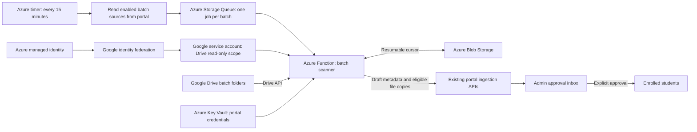

# Arks: Azure automation + direct Google Drive integration

Prepared for Azure subscription `a23b413f-dbe1-4a62-a9f9-62a6327fae00` and Google project `gen-lang-client-0246520454`.

**Status: implementation and local tests complete; cloud resources have NOT been created or verified from this workspace.** No signed-in Azure/GCP deployment identity is connected here. Account IDs select resources but do not grant deployment permissions. Run the scripts below in your signed-in Cloud Shells. They create resources; Azure usage is billable.

This package adds an Azure scanner to the existing portal. The portal UI, database and attachments continue on the current hosting service. Moving the entire portal to Azure would be a separate hosting/storage migration.

## Architecture



No ChatGPT/Gemini calls are made by this worker. Your existing generators continue saving their output in Drive. Google hosts the files and provides identity/token APIs; all scanner scheduling and execution runs in Azure. A plain API key cannot read private Drive folders.

## Resources the scripts create

| Provider | Resources and purpose |
|---|---|
| Azure | `rg-arks-drive-automation`; Linux Python 3.12 Function App on Flex Consumption; StorageV2 account with queue and private checkpoint container; user-assigned managed identity; Key Vault; Application Insights created by Function CLI defaults and its logging resources |
| Microsoft Entra | Single-tenant application/audience and service principal, without a password; identifies the target audience for federation |
| Google | `arks-drive-reader` service account; `arks-azure` workload identity pool; provider trusting only the selected Azure tenant and managed identity object ID |
| Google APIs | `drive.googleapis.com`, `iam.googleapis.com`, `iamcredentials.googleapis.com`, `sts.googleapis.com` |

Google Drive authorization is `drive.readonly` plus Viewer sharing on specific folders. No project-wide Editor role, domain-wide delegation, downloaded private key, Google compute or Google scheduler is needed. This does not change any existing Gemini project configuration; the setup adds the required APIs and identity resources.

Azure host storage uses a connection string managed in Function App settings; Google federation is keyless. Portal service credentials are Key Vault references. Do not interpret keyless Google access as removing all application secrets.

## 1. Create Azure resources

Open [Azure Cloud Shell](https://shell.azure.com/) in **Bash**, upload/extract this package, and enter its `azure` directory. Use an account with subscription resource creation and role-assignment permissions, and permission to create Entra application registrations. Subscription Contributor alone cannot create the Key Vault role assignments; Owner or an appropriate RBAC administrator role is also needed. The script expects an interactive user sign-in.

```bash
bash setup-azure.sh
```

Default region: `centralindia`. The script checks Flex availability and stops with supported regions if unavailable. To choose another supported region:

```bash
LOCATION=eastus bash setup-azure.sh
```

It writes `azure-config.json`, containing resource identifiers only. Download that file to transfer to Google Cloud Shell. Both functions remain disabled. Re-running provisioning also disables them deliberately; use `operate.py` for routine operations.

## 2. Create Google API access

Open [Google Cloud Shell](https://shell.cloud.google.com/?project=gen-lang-client-0246520454). Upload `setup-google.sh` and `azure-config.json` into the same directory. You need permissions to enable services, create/manage service accounts, and administer workload identity pools and service-account IAM policies (for example Service Usage Admin, Service Account Admin and Workload Identity Pool Admin, scoped to this project).

```bash
bash setup-google.sh
```

The script creates `google-config.json`. Download it and upload it into the `azure` directory in Azure Cloud Shell. Both configuration JSON files contain identifiers only and are safe to transfer between your own Cloud Shell sessions.

## 3. Share the Drive folder

In Drive, share this batch folder with **Viewer** access:

- Folder: [DevOps - Batch 01-11-26](https://drive.google.com/drive/folders/1HmC2BSeP8xW3XTOaPCwBVyheUeHYAar9)
- Service-account email: `arks-drive-reader@gen-lang-client-0246520454.iam.gserviceaccount.com`

For future batches, either share each folder with the same identity or place batch folders under an appropriately shared parent. In the portal's batch editor, enter the batch name and folder URL; no Azure schedule edits are needed. Exact folder names also work when they uniquely identify one accessible folder. URLs avoid duplicate-name ambiguity. If your Workspace disallows external/service-account sharing, its administrator must permit the intended access; creating an API key does not bypass that policy.

## 4. Configure portal credentials and deploy

Back in Azure Cloud Shell, run:

```bash
python3 configure-deploy.py
```

This prompts privately for the hosting and importer credentials, stores them in Key Vault through stdin, sets non-secret federation configuration, and deploys the Python package with Azure remote build. No credentials belong in chat, Git, screenshots or this package. Key Vault role propagation may take a few minutes after initial setup; retry if access has not propagated yet.

The existing portal requires both `OAI-Sites-Authorization: Bearer <hosting token>` and `X-Arks-Importer-Token: <importer token>`. Its server holds the SHA-256 fingerprint in `IMPORTER_TOKEN_SHA256`. Currently these use the same service token; the worker supports separate values if the portal fingerprint is updated. Tokens must be supplied through the site's authorized service-credential workflow. A previously exposed hosting token was reported in this conversation; explicit rotation remains pending. Resolve that credential handoff before production activation. The scripts cannot create or rotate Sites credentials.

Do not grant the worker a student/admin browser session, broaden the portal audience, or put private tokens in a folder URL.

## 5. Verify and activate

The deployment does not activate recurring scans. From the same Azure Cloud Shell directory:

```bash
python3 operate.py smoke
```

This enables only the queue worker, manually invokes one dispatch using a function host key kept in memory, then checks portal Run history for actual Azure completion. It can wait up to 45 minutes. If a batch is partial, rerun to continue from its cursor. If another importer has the 50-minute source lease, wait for that run to finish before retrying. A successful local test or code deployment alone is not a successful cloud import.

In the portal, confirm the run and inspect imported items. Pending documents must remain invisible to students; restricted workbooks must remain restricted. The worker never calls the admin approval endpoint. For attachment verification, open one copied document in the admin review flow.

After a successful smoke test:

```bash
python3 operate.py enable
```

This requires a successful smoke verification recorded for the same app within the last 24 hours. The timer runs every 15 minutes (Azure UTC cron; an interval has no time-zone offset issue). Observe the first scheduled Azure run, then pause the old ChatGPT task **Import Arks batch materials for approval**, ID `Automation_898ef61c538c819186e2504db6932237`. Leave the PPT/notes/test-generation tasks in their existing state. Neither the old task nor any cloud schedule has been changed by preparing this package.

Pause/status commands:

```bash
python3 operate.py pause
python3 operate.py status
```

Pausing prevents new timer dispatches; already queued/in-flight work may finish. For an emergency stop, also disable `scan_batch` in Function App settings. Review `arks-drive-scans-poison` for exhausted queue retries and Application Insights for failures. App logs intentionally omit SDK exception bodies/headers and secrets; portal Run history carries safe diagnostic messages.

## API contract

The worker calls existing, authenticated portal APIs. It does not need a new public Azure HTTP endpoint.

| Method and path | Purpose |
|---|---|
| GET `/api/automation/sources` | Discover all configured batch sources each timer run |
| POST `/api/automation/claim` | Claim exclusive 50-minute source lease |
| POST `/api/automation/resolve` | Verify and bind the configured Drive folder |
| POST `/api/automation/ingest` | Up to 50 file metadata records, draft/restricted only |
| POST `/api/automation/upload` | Attach original bytes to a pending import |
| POST `/api/automation/finish` | Record succeeded, partial or failed status |
| GET `/api/automation/state` | Read completion evidence for deployment verification |

The detailed request schema is in the existing `docs/AUTOMATION-RUNBOOK.md`. That document also describes the old ChatGPT importer; this package replaces its execution and authentication-to-Google steps, preserving the portal contract and approval policy. The Azure worker intentionally has no `prepare`, admin review, grade-writing, or student-record code path.

## Scaling and limitations

- Queue fan-out isolates batches. A portal lease prevents concurrent scans of one source; different batches can execute concurrently. Flex has a configured maximum of 40 instances, subject to regional quota. This is a capacity cap, not 40 permanently running machines.
- Each invocation reads at most 200 pages (50 children per page) or approximately 40 minutes, then saves a continuation. Blob cursors are keyed by source and folder generation; changing the configured folder discards the old cursor. A page is advanced only after all intended copies succeed. A failed attachment deliberately holds that page for retry and is visible in Run history.
- Every completed pass starts a fresh full enumeration on the next interval. This supports new/revised files and nested folders; Drive Changes API delta cursors are a future quota optimization for very large libraries. Page tokens can expire and then safely restart enumeration.
- Files deduplicate by source, generation, Drive ID and revision. New revisions need new approval; the prior approved copy remains available until replacement approval. Source deletion does not automatically unpublish an approved snapshot.
- Supported binary documents up to 20 MB are copied. Native Google documents, Forms, videos and oversized files remain links and retain Google permissions; they are not automatically readable by students merely because the scanner has Viewer access. Admin must check student access or supply an appropriate downloadable/exported version. No Drive sharing is changed by this worker.
- Drafts, answers and results are restricted by existing server rules. Individual lab submission folders (`lab_answers`, `student_submissions`, `submissions`) and branding/reference folders are skipped; shortcuts are not followed. Filename classification is a heuristic, so human review remains mandatory.
- This is content ingestion, not a grading engine. Individual marks are not extracted from result workbooks or released to students. Google Form approval requires the published student `/viewform` URL.
- Queues use at-least-once delivery. Existing per-source leases and idempotent ingestion make replay safe. Unexpected termination may retain a lease until its 50-minute expiry. Queue retries and the next timer run recover it.

## Local validation

```bash
python3 -m venv .venv
.venv/bin/pip install -r function/requirements.txt
.venv/bin/python -m unittest discover -s tests -v
bash -n setup-azure.sh setup-google.sh
```

Tests cover pending-only ingestion, restricted-file exclusions, duplicate copies, active leases, resumable pagination, folder generation changes, upload failure replay, changed-download rejection, folder ambiguity, parent checks, link-only files, redirect refusal and Function binding indexing. Cloud IAM, quota, Entra policy, Key Vault references and actual Drive reads require the live smoke check.

Official references: [Azure Flex setup/deployment](https://learn.microsoft.com/en-us/azure/azure-functions/flex-consumption-how-to), [Google federation with Azure](https://docs.cloud.google.com/iam/docs/workload-identity-federation-with-other-clouds), [Drive authentication scopes](https://developers.google.com/workspace/drive/api/guides/api-specific-auth).
