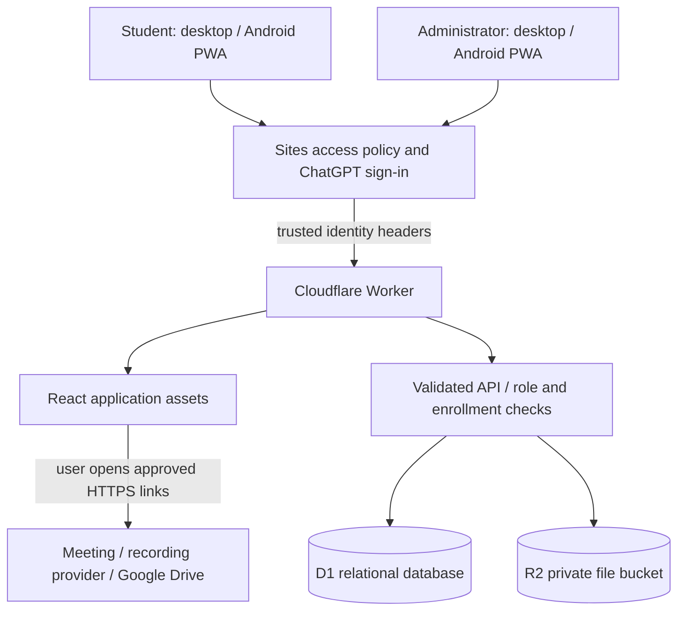
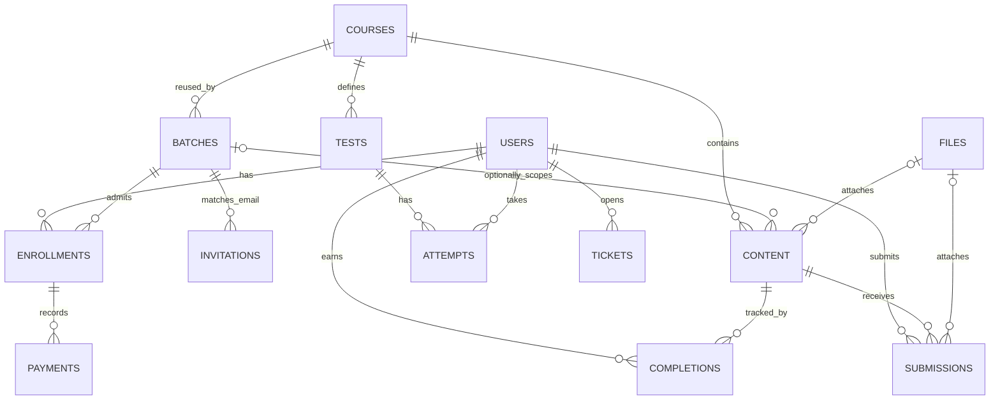
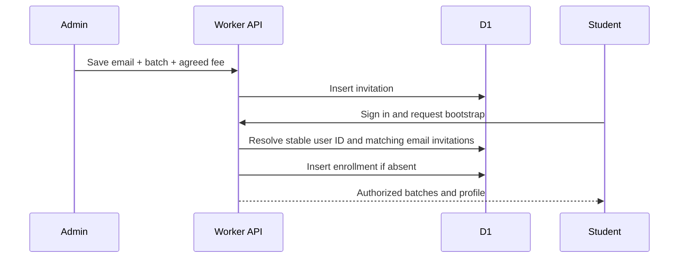
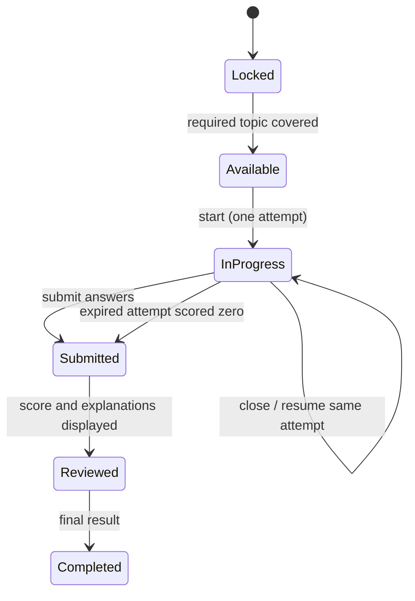

# Architecture

## System context

## Data relationships

Each progress, attempt, submission and query carries a batch ID. A student can join another batch without overwriting the original batch’s learning history. Content is shared at course level unless assigned to a particular batch. A batch’s course is immutable after creation to preserve historical enrollment relationships.

Money is stored in integer minor currency units. The initial UI assumes two decimal minor units (INR/USD/EUR); use two-decimal currencies. An enrollment snapshots its agreed fee when activated. Editing an invitation later does not rewrite an existing enrollment’s fee.

## Enrollment flow

The first authenticated request claims the singleton owner record atomically. This requires initializing the app while its Sites audience remains owner-only. All subsequent identities default to student unless an administrator assigns a role. The host must overwrite/validate identity headers. Never deploy this Worker behind an untrusted proxy that passes client-supplied identity headers.

## Assessment lifecycle

Questions and duration are snapshotted when the attempt starts. Client responses contain prompts and options, never answer keys. The server owns the expiry and grading. Late requests beyond a ten-second delivery allowance score zero. Submissions are idempotent; results remain available. This is a learning assessment system, not a proctored certification platform.

## Completion definition

Denominator: currently published notes, slides, guides, recordings and labs visible in the selected course/batch. Notes/slides/guides/recordings are self-reported. Labs are completed by admin acceptance. Live attendance, tests and SOP are excluded from that percentage. Tests are reported separately. Changing the published resource set changes the current percentage; completed records remain stored. This is not an immutable accreditation transcript.

## Growth strategy

1. Add batches by data entry, reusing courses. No code changes are necessary.
2. Use the existing relational keys and course/attempt indexes to keep queries scoped.
3. Add database-side pagination before administrator datasets reach 5,000 rows (the current read cap is explicit).
4. Separate course versions before changing curricula that require historical completion guarantees.
5. For many simultaneous tests, benchmark Worker/D1 capacity, add request throttling and monitoring, and shard by institution if necessary.
6. Large video should stay with a streaming provider. R2 is for small learning files and submissions.
7. Add an asynchronous queue for notifications, malware scanning and large exports when those integrations are enabled.

The model supports growing batches; no large-scale capacity benchmark has been performed. This application currently serves one institution, not independent multi-tenant institutions.
