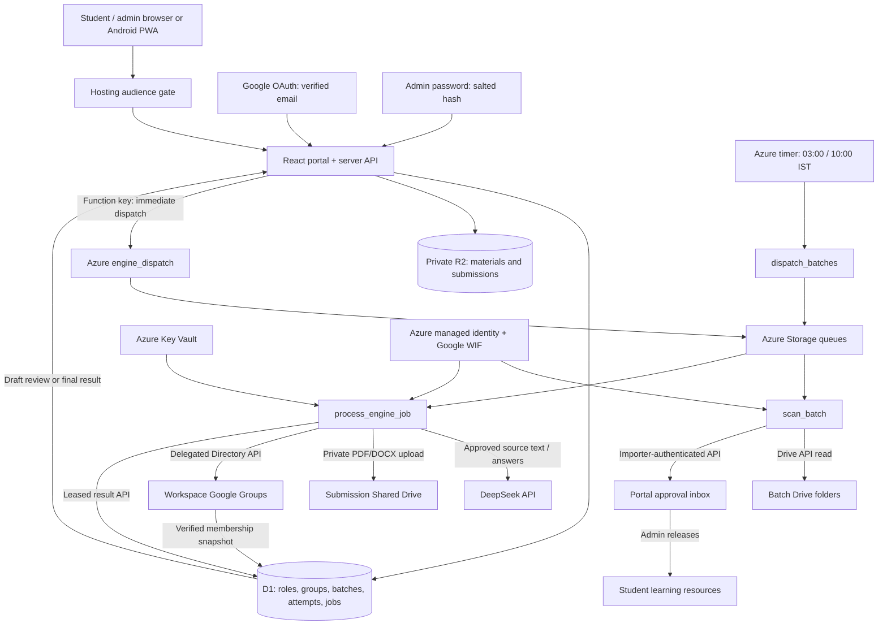

# Campus architecture

## Authorization and data boundaries
The existing hosted portal stays owner-private until production authentication and access are configured. The portal itself currently runs on Sites Worker/D1/R2, not in Azure. Azure runs the scanning and job engine; Google stores class recordings/source files and optional submission copies. The diagram does not imply an already-completed hosting migration.

Student requests require active identity plus batch enrollment; group-enforced batches recheck membership. Admin routes require an admin role. Google group membership cannot assign the admin role. Admin passwords create an authenticated session, never an authentication bypass.

The browser never calls DeepSeek or Azure with a privileged key. Portal APIs queue jobs; Azure claims a lease, reads only the job's authorized private files, submits structured results, and releases the job. AI drafts are unpublished. Submitted attempts are immutable except grading feedback/marks; objective answers are checked against the approved snapshot, written grades are bounded by the allocated marks. Rounding is to hundredths, with total allocation exactly 100.

## Configuration map
| Location | Settings |
|---|---|
| Portal server | `AUTH_MODE`, `GOOGLE_CLIENT_ID`, `GOOGLE_CLIENT_SECRET`, `AZURE_ENGINE_URL`, `AZURE_ENGINE_KEY`, existing `IMPORTER_TOKEN_SHA256` |
| Azure Key Vault | Existing hosting/importer tokens; `arks-deepseek-key` |
| Function App | Key Vault references, `DEEPSEEK_MODEL`, existing WIF/storage/schedule, optional `GOOGLE_WORKSPACE_ADMIN`, `GOOGLE_DIRECTORY_SERVICE_ACCOUNT` |
| Google Cloud | Drive API, IAM Credentials API, WIF provider, reader service account; OAuth Web client; optional delegated Directory service account and Admin SDK |
| Google Admin Console | Existing Google Groups; delegated Directory scopes; suitable Shared Drive membership |
| Portal admin | Batch Drive source, submission folder ID, support links, course overview, SOP roadmap, session series, access groups, fees, approved assessments |

Future batches reuse the engine, with their own source folder, group, submission destination and batch configuration. Adding a batch does not require a new Function App or a new AI key.
